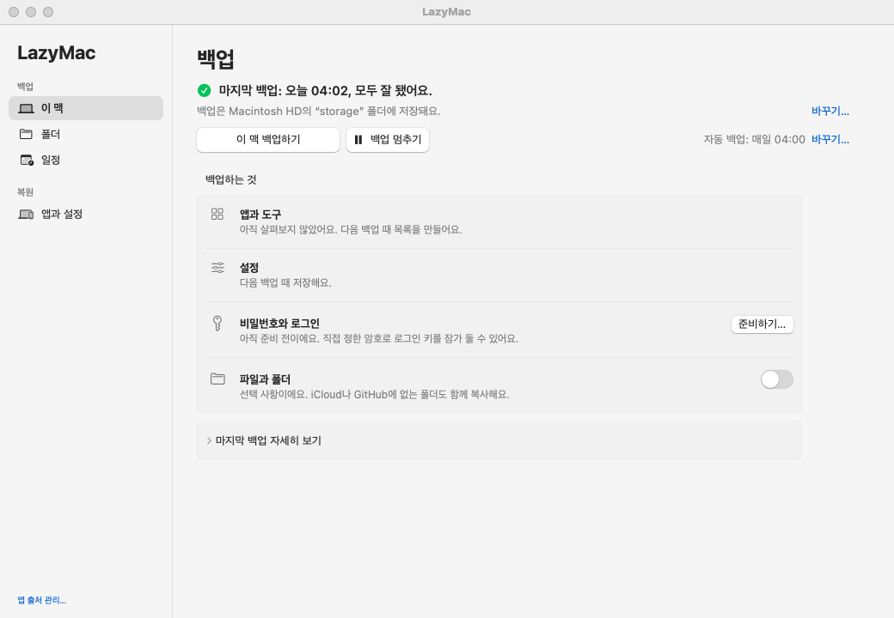
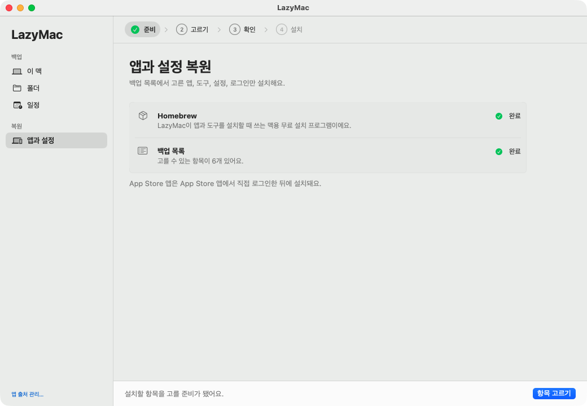
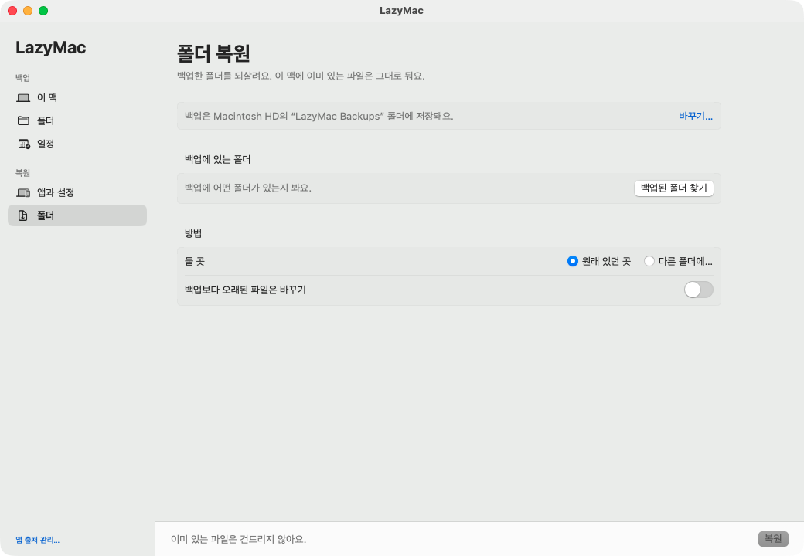

<div align="center">

# LazyMac

**이 맥의 앱과 도구를 다음 맥에 깨끗하게 새로 설치해요.**

[English](README.md) · [내려받기](https://github.com/floweredao/LazyMac/releases/latest) · [날짜별 기록](https://lazymac-history.pages.dev/)

</div>

LazyMac의 목표는 하나예요. 다음 맥을 이 맥과 같은 앱과 도구로, 깨끗하게 새로 설치해 꾸미는 거예요.\
프로젝트 폴더나 이 맥의 파일 백업은 원할 때 켜서 쓰는 선택 기능이에요.

이 맥에 있는 앱, 도구, 설정, 로그인 정보를 목록으로 정리해 Google 드라이브에 백업해요.\
새 맥에서는 그 목록에 있는 것을 새로 설치해요.\
몇 년 묵은 파일과 찌꺼기는 옮기지 않아요.

- **새 맥에 깨끗하게 설치**: 가져올 것을 고르고, 확인하고, 설치해요.
- **버튼 하나로 백업**: 기본은 Google 드라이브이고, 폴더나 외장 디스크도 쓸 수 있어요.
- **자동 백업**이 매시간, 매일, 매주 돌아요. 앱을 닫아 둬도 돌아요. 맥이 꺼져 있거나 잠들었거나 인터넷이 없어서 놓친 백업은 할 수 있게 되는 대로 한 번 해요.
- **언제든 멈추기**: 버튼 하나로 도는 백업을 안전하게 멈추고, 다시 켤 때까지 모든 백업을 쉬어요.
- **비밀번호는 내가 정한 암호로 잠근** 파일 하나에 담겨요.
- **폴더 백업은 선택**: 프로젝트 같은 폴더 복사는 직접 켜기 전까지 꺼져 있어요.
- **아무것도 지우지 않아요**: 백업은 파일을 지우지 않고, 복원은 있는 파일을 덮어쓰지 않아요.



## 준비물

| 하려는 일 | 필요한 것 |
|---|---|
| 앱 쓰기 | macOS 14 이상. 그 밖에는 없어요. `LazyMac.app`이 쓰는 스크립트를 안에 넣고 다녀요. |
| 구글 드라이브로 백업 | [rclone](https://rclone.org) (`brew install rclone`)과 `rclone config`로 만든 리모트 하나. 폴더나 외장 디스크로 백업하면 둘 다 필요 없어요. |
| 설정·폴더 백업 | [gitleaks](https://github.com/gitleaks/gitleaks) (`brew install gitleaks`). 파일마다 비밀값이 있는지 보고, 있는 파일은 빼고 복사해요. |
| 비밀번호를 한 파일에 묶기 | [age](https://github.com/FiloSottile/age) (`brew install age`). |
| 터미널로 목록 다루기 | [bun](https://bun.sh)과 `jq`. |
| 소스에서 빌드 | 전체 Xcode와 bun ([소스에서 빌드하고 테스트하기](#소스에서-빌드하고-테스트하기) 참고). |

## 설치

1. [Releases](https://github.com/floweredao/LazyMac/releases/latest)에서 `LazyMac-<버전>.zip`을 내려받아 풀고, `LazyMac.app`을 `/Applications`로 옮겨요.
2. 앱을 열어요. Apple 공증을 받지 않은 앱이라 처음에는 macOS가 막아요. **시스템 설정 > 개인정보 보호 및 보안**에서 **그래도 열기**를 눌러요.

## 백업

### 백업하는 것

| 항목 | 저장하는 것 | 가져오는 방법 |
|---|---|---|
| 앱과 도구 | 설치된 앱, Homebrew 패키지, App Store 앱, 전역 명령줄 도구, 글꼴, 백그라운드 작업 목록 | 이 맥을 읽기만 하는 스캔 |
| 설정 | 셸, Git, tmux, npm, SSH 설정 파일과 Dock·Finder 설정 | `bin/settings.sh`. 비밀값이 든 것 같은 파일은 건너뛰어요 |
| 비밀번호와 로그인 정보 | SSH 키, 로그인 파일, 고른 키체인 항목을 내 암호로 잠근 파일 하나 | `bin/secrets-pack.sh` ([자세히](docs/secrets.md)) |
| 파일과 폴더 (선택) | iCloud나 GitHub에 없는, 직접 고른 폴더. 직접 켜기 전까지 꺼져 있어요 | `bin/nogit-backup.sh` |

저장하기 전에 늘 `gitleaks`로 검사해서, 비밀번호가 목록에 섞여 들어가지 않아요.

### 처음 백업하기

1. **LazyMac**을 열어요. 짧은 시작 안내가 앱이 하는 일을 보여 주고, 백업을 둘 곳을 물어요.
2. **Google 드라이브를 연결해요(기본).** **rclone 설치**를 눌러요. rclone은 Google 드라이브로 파일을 복사하는 무료 도구예요. 그다음 **Google 드라이브 연결…** 버튼을 누르고 브라우저에서 Google에 로그인해요. rclone은 LazyMac이 만든 파일만 볼 수 있어요.
   - **폴더를 쓰려면** **대신 폴더 쓰기…** 버튼을 눌러요. 외장 디스크 폴더는 추가 도구나 로그인이 필요 없어요.
   - 장소는 나중에 **설정 > 백업 장소**(`⌘,`)에서 바꿀 수 있어요.
3. **이 맥 백업하기**를 눌러요. 1분쯤 걸려요. **백업하는 것** 아래 항목마다 저장되면 초록 체크가 붙어요.
4. **비밀번호 잠그기(추천).** **비밀번호와 로그인 정보** 옆 **준비하기…** 버튼을 누르고 암호를 정해요. 암호는 비밀번호 관리자에 꼭 적어 두세요. 암호가 없으면 묶음을 열 수 없어요.
5. **폴더 복사(선택, 처음엔 꺼짐).** **파일과 폴더**를 켜고 **백업 > 폴더**에서 폴더를 골라요. 빌드 결과물(`node_modules`, `DerivedData` 등), 비밀값으로 보이는 파일(`.env`, `*.pem`, SSH 키), 이미 Git 저장소인 폴더는 건너뛰어요.

### 자동 백업

1. **백업 > 일정**을 열어요.
2. **자동으로 백업하기**를 켜고 주기(매시간, 몇 시간마다, 매일, 매주)를 고른 뒤 **적용**을 눌러요.
3. 바로가기 버튼으로 LazyMac에 **전체 디스크 접근 권한**을 줘요. 그래야 백그라운드 백업이 모든 폴더를 읽을 수 있어요.

LazyMac은 LaunchAgent(`local.lazymac-daily`)를 설치해서 앱을 닫아 둬도 같은 백업을 돌려요. **백업** 화면에 마지막 결과가 나와요. 실패하면 "백업 디스크가 연결되어 있지 않아요"처럼 이유를 쉬운 말로 알려 주고, 고치는 버튼도 보여 줘요. 기록은 `~/Library/Logs/lazymac-daily/`에 30일 동안 남아요.

**놓친 백업.** 로그인할 때와 30분마다도 확인해요. 정해진 시각에 맥이 꺼져 있었거나, 잠들었거나, 로그아웃했거나, 인터넷이 없었으면 할 수 있게 되는 대로 한 번 백업해요. 여러 번 놓쳤어도 한 번만 해요. 잠에서 깬 뒤 1분은 와이파이를 기다려요. 놓친 백업을 다음 정시 전 주기의 절반 안에 했으면 그 정시는 건너뛰어요. 자동 백업이 실패하면 15분, 30분, 60분, 120분 뒤에 다시 해요. 알림은 안 좋은 상황마다 한 번만 와요: 3번 연달아 실패했거나, 마지막 백업이 주기의 2배보다 오래됐을 때예요.

**핫스팟과 저데이터 모드.** **일정**에서 **데이터 요금이 드는 연결에서는 기다리기**를 켜면 그런 연결에서는 자동 백업이 돌지 않아요(처음엔 꺼짐). **이 맥 백업하기**는 그래도 돼요. 한 번 물어본 뒤 백업해요.

**백업** 화면의 **현황**에서 백업이 최신인지, 도는 중인지(단계와 진행률, LazyMac을 닫아 둔 사이 시작된 백업도), 밀렸는지와 그 이유, 멈췄는지를 한눈에 봐요. 마지막 성공, 다음 백업, 최근 문제, 백업 장소가 얼마나 찼는지도 나와요.

**백업** 화면의 **백업 멈추기**는 도는 백업을 안전한 지점에서 멈추고(복사가 중간에 끊겨도 반쯤 쓴 파일은 남지 않아요), **백업 다시 켜기**를 누를 때까지 자동 백업도 버튼 백업도 시작하지 않아요.

## 새 맥으로 복원

### 옛 맥을 떠나기 전에

1. **이 맥 백업하기**를 한 번 더 눌러 백업을 최신으로 만들어요.
2. 비밀번호를 새로 만들거나 바꿨다면 **비밀번호와 로그인 정보** 옆 **다시 잠그기…** 버튼을 눌러요.
3. 큰 앱 보관함처럼 LazyMac이 백업하지 않는 것은 외장 디스크에 따로 복사해요.

### 새 맥에서

1. macOS 첫 설정을 마치고 Apple ID로 로그인한 뒤, **App Store를 열어 로그인해요.** 그래야 App Store 앱이 설치돼요.
2. LazyMac을 설치해요([설치](#설치) 참고).
3. 옛 맥과 **같은 장소**를 골라요. LazyMac이 있는 백업을 찾아 그 목록을 써요.
   - **Google 드라이브**: 같은 Google 계정을 연결해요. **드라이브 안 폴더**에는 옛 맥이 쓰던 폴더를 적어요. 옛 맥의 **설정 > 백업 장소**에서 볼 수 있어요.
   - **폴더**: 백업 디스크를 연결하고 같은 폴더를 골라요.
4. **복원 > 앱과 설정**을 열고 네 단계를 따라가요.
   1. **준비**: 버튼 하나로 Homebrew를 설치해요. 백업 목록을 불러와요.
   2. **고르기**: 맥 프로필(`pro`, `air` 등)을 고르고, 추가 항목을 켜고 끄거나, 하나씩 골라요.
   3. **확인**: 설치할 것을 확인해요.
   4. **설치**: 진행 상황을 봐요. `sudo` 비밀번호나 암호가 필요하면 기록 아래 입력 칸이 주황색으로 바뀌어요. 거기에 입력해요.
5. 폴더를 백업했다면 **복원 > 폴더**에서 **백업된 폴더 찾기**를 누르고, 폴더를 골라 **복원**을 눌러요. **백업보다 오래된 파일은 바꾸기**를 켜지 않으면 이 맥에 있는 파일은 건드리지 않아요.





### 직접 해야 하는 것

- **LazyMac이 설치할 수 없는 앱**: 내려받기 페이지를 열어 줘요. 그 앱과 "직접 설치"로 표시된 앱(예: Visual Studio Code)을 설치해요.
- **권한**: 앱이 물을 때 **시스템 설정 > 개인정보 보호 및 보안**에서 손쉬운 사용, 화면 기록, 전체 디스크 접근 권한을 줘요.
- **다시 로그인**: 브라우저, 메신저, 메일 앱, 비밀번호 관리자, VPN처럼 로그인 정보를 맥 하드웨어에 묶는 앱이에요.
- 되살린 키체인 항목을 앱이 써도 되는지 macOS가 물으면 **항상 허용**을 골라요.

아직 빠진 것을 보려면 터미널에서 `/Applications/LazyMac.app/Contents/Resources/bin/setup.sh check`를 돌려요(이 저장소를 받아 두었다면 `bin/setup.sh check`). 목록에 있는데 이 맥에 없는 항목을 모두 보여 줘요.

### 터미널로 복원

목록을 GitHub 저장소에 두었다면 앱 없이도 복원할 수 있어요.

```sh
/bin/bash -c "$(curl -fsSL https://raw.githubusercontent.com/Homebrew/install/HEAD/install.sh)"
eval "$(/opt/homebrew/bin/brew shellenv)" && brew install gh && gh auth login
gh repo clone alex/lazymac ~/Documents/lazymac
~/Documents/lazymac/bin/setup.sh                 # ✅ 표시한 것 모두
~/Documents/lazymac/bin/setup.sh --profile air,light   # 또는 프로필 하나
```

단계마다 이미 된 것은 건너뛰어서, 다시 돌려도 안전해요. 단계별 설명은 [복원 안내](docs/restore-ko.md)에 있어요.

## 소스에서 빌드하고 테스트하기

`swift build`에는 **전체 Xcode**가 필요해요. 명령줄 도구(Command Line Tools)만으로는 안 돼요. 앱이 SwiftUI 매크로를 쓰는데 명령줄 도구에는 매크로 플러그인이 없어서, `@State` 줄마다 `external macro implementation type 'SwiftUIMacros.StateMacro' could not be found` 오류가 나요. 소스가 깨진 것처럼 보이지만 도구가 없는 것뿐이에요. 명령 하나에만 Xcode를 가리키려면 이렇게 해요.

```sh
DEVELOPER_DIR=/Applications/Xcode.app/Contents/Developer swift build --package-path app
```

맥 전체에 한 번 정해 두려면 `sudo xcode-select -s /Applications/Xcode.app`을 써요.

```sh
git clone https://github.com/floweredao/LazyMac.git && cd LazyMac
app/build.sh                              # app/build/LazyMac.app과 릴리즈용 zip
for t in tests/*.sh; do zsh "$t" || break; done   # 테스트 전체, 스크립트 15개
zsh tests/due.sh                          # 또는 하나만
```

스크립트마다 검사 한 줄에 `ok` 또는 `FAIL`을 찍고, 하나라도 실패하면 0이 아닌 값으로 끝나요. `rclone`, `gitleaks`, `age`가 깔려 있어야 하고, 임시 폴더·임시 키체인·가짜 `defaults`로만 돌아서 이 맥의 실제 자료나 설정은 읽지 않아요. 같은 15개가 모든 풀 리퀘스트에서 돌아요([`.github/workflows/tests.yml`](.github/workflows/tests.yml)).

## 설정

모두 기본값이 있고, 파일은 앱이 알아서 써요. LazyMac을 다른 곳으로 보내고 싶을 때만 값을 정해요. 테스트도 같은 변수로 임시 폴더를 쓰게 만들어요.

| 변수 | 기본값 | 가리키는 것 |
|---|---|---|
| `LAZYMAC_DATA` | `storage.conf`의 `data` 줄, 없으면 `~/LazyMac-data` | 자료 폴더: 목록, 날짜별 기록, 저장한 설정, 설치 목록 |
| `LAZYMAC_STORAGE_CONF` | `~/Library/Application Support/lazymac/storage.conf` | 백업이 가는 곳: `backend`, `remote`, `local`, `files` ([자세히](docs/advanced-ko.md)) |
| `LAZYMAC_BACKUP_CONF` | `~/Library/Application Support/lazymac/backup.conf` | 복사할 폴더와 추가로 뺄 패턴 ([자세히](docs/advanced-ko.md)) |
| `LAZYMAC_HOOKS` | `~/.config/lazymac/hooks` | `before-daily`, `on-failure` 스크립트 ([자세히](docs/advanced-ko.md)) |
| `LAZYMAC_HOST` | `scutil --get LocalHostName` | `machines.tsv`와 `inventory/`에 쓰는 이 맥의 이름 |
| `LAZYMAC_KEYCHAIN` | `~/Library/Keychains/login.keychain-db` | 암호화한 비밀번호 묶음이 읽고 쓰는 키체인 ([자세히](docs/secrets.md)) |
| `LAZYMAC_CF_KEYCHAIN` | `lazymac-cloudflare` | 날짜별 기록 페이지용 Cloudflare 토큰이 들어 있는 키체인 서비스 ([자세히](docs/advanced-ko.md)) |
| `LAZYMAC_PRIVATE_WORDS` | `~/.config/lazymac/private-words` | 공개 기록 페이지에 절대 나가면 안 되는 낱말 |
| `LAZYMAC_DAILY_LOGDIR` | `~/Library/Logs/lazymac-daily` | 자동 백업이 기록을 남기는 곳 |
| `LAZYMAC_LAUNCHAGENTS_DIR` | `~/Library/LaunchAgents` | 자동 백업 작업이 설치되는 곳 |
| `LAZYMAC_PRUNE_LIMIT` | `10` | 한 번의 자동 정리가 지울 수 있는 항목 수 |

자료 폴더 안에는 `catalog.tsv`(목록 자체), `machines.tsv`(어느 맥이 주 맥인지와 처음 켜지는 프로필), `groups.tsv`(하위 분류 제목), `profiles/*.txt`, `setup/`(만들어진 설치 목록), `secrets/manifest.txt`가 있어요. [`example/`](example)에 복사해서 쓸 기본 묶음이 있어요. 이 경로들도 `LAZYMAC_SNAPSHOT_DIR`, `LAZYMAC_INVENTORY_DIR`, `LAZYMAC_PROFILES_DIR`, `LAZYMAC_SETUP_DIR`, `LAZYMAC_MACHINES`, `LAZYMAC_MANIFEST`, `LAZYMAC_SECRETS_OUT`로 옮길 수 있어요. 소스에 남은 다른 `LAZYMAC_*` 이름은 시계·네트워크·`launchctl`·`defaults`를 대신하는 테스트용이에요.

## 더 보기

| 문서 | 내용 |
|---|---|
| [자세한 안내](docs/guide-ko.md) | 앱 화면, 앱 출처, 프로필, 여러 맥, 릴리즈 빌드 |
| [복원 안내](docs/restore-ko.md) | 옛 맥 점검 목록, `bin/setup.sh` 단계, 직접 할 일 |
| [비밀번호와 로그인 정보](docs/secrets.md) | 암호화 묶음에 들어가는 것과 되살리는 방법 |
| [목록 관리](docs/maintain.md) | `catalog.tsv`, 스캔, 자동 정리, 프로필, 스냅샷 |
| [고급 설정](docs/advanced-ko.md) | `storage.conf`, `backup.conf`, 훅, 환경 변수 |
