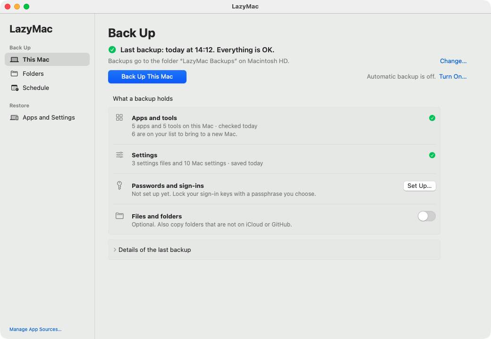
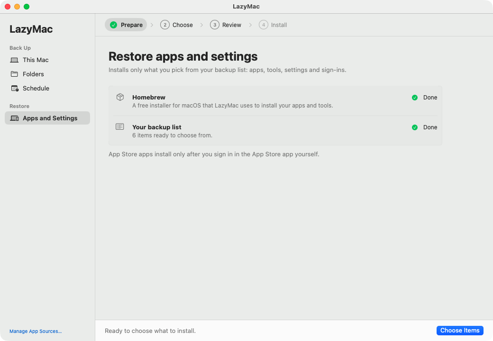
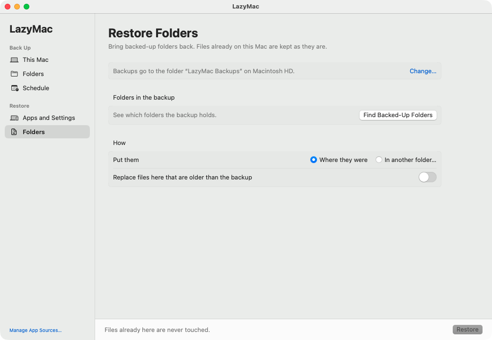

<div align="center">

# LazyMac

**Install this Mac's apps and tools on your next Mac, clean.**

[한국어](README-ko.md) · [Download](https://github.com/floweredao/LazyMac/releases/latest) · [Daily history](https://lazymac-history.pages.dev/)

</div>

LazyMac has one goal: set up your next Mac with the same apps and tools as this one, installed fresh.\
Backing up project folders and other files on this Mac is optional, and stays off until you turn it on.

It keeps a list of the apps, tools, settings, and sign-ins on this Mac and backs it up to Google Drive.\
On the new Mac, it installs fresh copies of what is on that list.\
Years of old files and leftovers stay behind.

- **Clean install on a new Mac**: pick what to bring, review it, and install.
- **One-click backup** to Google Drive by default, or to a folder or external disk.
- **Automatic backups** every hour, day, or week, even when the app is closed. A backup missed while the Mac was off, asleep, or offline runs once as soon as it can.
- **Pause anytime**: one button stops a running backup safely and keeps every backup waiting until you resume.
- **Passwords locked with your passphrase** in one encrypted file.
- **Folder backup is optional**: copying folders such as projects is off until you turn it on.
- **Nothing is deleted**: backups never remove files, and restores never overwrite yours.



## Requirements

| To | You need |
|---|---|
| Run the app | macOS 14 or newer. Nothing else: `LazyMac.app` carries the scripts it runs. |
| Back up to Google Drive | [rclone](https://rclone.org) (`brew install rclone`) and one remote from `rclone config`. A folder or external disk needs neither. |
| Back up settings and folders | [gitleaks](https://github.com/gitleaks/gitleaks) (`brew install gitleaks`), which checks each file for secrets before it is copied, and skips the ones that hold any. |
| Lock passwords in one file | [age](https://github.com/FiloSottile/age) (`brew install age`). |
| Work with the list from Terminal | [bun](https://bun.sh) and `jq`. |
| Build from source | Full Xcode and bun (see [Build and test from source](#build-and-test-from-source)). |

## Install

1. Download `LazyMac-<version>.zip` from [Releases](https://github.com/floweredao/LazyMac/releases/latest), unzip it, and move `LazyMac.app` to `/Applications`.
2. Open it. macOS blocks it the first time because the app is not notarized by Apple. Go to **System Settings > Privacy & Security** and click **Open Anyway**.

## Back up

### What a backup holds

| Part | What is saved | Where it comes from |
|---|---|---|
| Apps and tools | The list of installed apps, Homebrew packages, App Store apps, global command-line tools, fonts, and background jobs | A read-only scan of this Mac |
| Settings | Shell, Git, tmux, npm, and SSH settings files, plus Dock and Finder settings | `bin/settings.sh`. A file that looks like it holds a secret is skipped |
| Passwords and sign-ins | SSH keys, sign-in files, and Keychain items you choose, in one file locked with your passphrase | `bin/secrets-pack.sh` ([details](docs/secrets.md)) |
| Files and folders (optional) | Folders you pick that are not already on iCloud or GitHub. Off until you turn it on | `bin/nogit-backup.sh` |

Every backup is checked with `gitleaks` before it is saved, so a stray password does not end up in the list.

### First backup

1. Open **LazyMac**. A short welcome explains what it does, then asks where backups go.
2. **Connect Google Drive (the default).** Click **Install rclone**, a free tool that copies files to Google Drive. Then click **Connect Google Drive…** and sign in to Google in your browser. rclone can see only the files LazyMac makes.
   - **To use a folder instead**, click **Use a Folder Instead…**. A folder on an external disk needs no extra tools or sign-in.
   - You can change the place later in **Settings > Backup Place** (`⌘,`).
3. Click **Back Up This Mac**. It takes about a minute. Each part under **What a backup holds** gets a green check when it is saved.
4. **Lock your passwords (recommended).** Next to **Passwords and sign-ins**, click **Set Up…** and choose a passphrase. Store it in a password manager: without it the bundle cannot be opened.
5. **Copy folders (optional, off at first).** Turn on **Files and folders**, then pick folders in **Back Up > Folders**. Build output (`node_modules`, `DerivedData`, ...), secret-looking files (`.env`, `*.pem`, SSH keys), and folders that are already Git repositories are skipped.

### Automatic backups

1. Open **Back Up > Schedule**.
2. Turn on **Back up automatically**, choose how often (every hour, every few hours, every day, or every week), and click **Apply**.
3. Click the shortcut to give LazyMac **Full Disk Access**, so background backups can read every folder.

LazyMac installs a LaunchAgent (`local.lazymac-daily`) that runs the same backup when the app is closed. The **Back Up** screen shows the last result. If a backup fails, it says why in plain words (for example "Your backup disk is not connected") with a button to fix it. Logs are kept for 30 days in `~/Library/Logs/lazymac-daily/`.

**Missed backups.** The job also checks at login and every 30 minutes. If the Mac was off, asleep, logged out, or offline at the scheduled time, it backs up once when it can, however many times were missed. A minute after waking it waits for Wi-Fi. If that catch-up ran less than half a period before the next scheduled time, the next one is skipped. A failed automatic backup tries again after 15 minutes, then 30, 60, and 120. You get one notification per bad stretch: after three failures in a row, or when the last backup is more than two periods old.

**Hotspots and Low Data Mode.** Turn on **Wait on connections that may charge for data** in **Schedule** to keep automatic backups from running there (off at first). **Back Up This Mac** still works: it asks first, then backs up.

**Status** on the **Back Up** screen shows, at a glance, whether backups are up to date, running (with the step and progress, also for a backup that started while LazyMac was closed), behind schedule and why, or paused; the last successful backup; the next one; the last problem; and how full the backup place is.

**Pause Backups** on the **Back Up** screen stops a running backup at a safe point (a cut-short copy leaves no half-written file) and keeps automatic and manual backups from starting until you click **Resume Backups**.

## Restore to a new Mac

### Before you leave the old Mac

1. Click **Back Up This Mac** once more, so the backup is current.
2. If you added or changed passwords, click **Update…** next to **Passwords and sign-ins**.
3. Copy anything LazyMac does not back up, such as large app libraries, to an external disk.

### On the new Mac

1. Finish the macOS setup, sign in with your Apple ID, and **open the App Store and sign in**. App Store apps install only after this.
2. Install LazyMac (see [Install](#install)).
3. Choose **the same place** as on the old Mac. LazyMac finds the existing backup and uses its list.
   - **Google Drive**: connect the same Google account. Under **Folder in Drive**, enter the folder the old Mac used. **Settings > Backup Place** on the old Mac shows it.
   - **A folder**: connect the backup disk and choose the same folder.
4. Open **Restore > Apps and Settings** and go through the four steps:
   1. **Prepare**: install Homebrew with one click. The backup list loads.
   2. **Choose**: pick a Mac profile (such as `pro` or `air`), turn add-ons on or off, or tick single items.
   3. **Review**: check what will be installed.
   4. **Install**: watch the progress. When `sudo` or the passphrase is needed, the input bar under the log turns orange. Type it there.
5. If you backed up folders, open **Restore > Folders**, click **Find Backed-Up Folders**, select folders, and click **Restore**. Files already on this Mac are never touched unless you turn on **Replace files here that are older than the backup**.





### What you still do by hand

- **Apps without an installer LazyMac can run**: LazyMac opens their download pages. Install them, along with apps listed as "by hand" (for example Visual Studio Code).
- **Permissions**: grant Accessibility, Screen Recording, or Full Disk Access in **System Settings > Privacy & Security** when each app asks.
- **Sign in again** to apps that tie sign-ins to the Mac's hardware: browsers, chat and mail apps, password managers, and VPNs.
- When macOS asks whether an app may use a restored Keychain item, choose **Always Allow**.

To check what is still missing, run `/Applications/LazyMac.app/Contents/Resources/bin/setup.sh check` in Terminal (or `bin/setup.sh check` in a copy of this repo). It lists every item on your list that is not on this Mac.

### Restore from Terminal

If your list lives in a GitHub repository, you can restore without the app:

```sh
/bin/bash -c "$(curl -fsSL https://raw.githubusercontent.com/Homebrew/install/HEAD/install.sh)"
eval "$(/opt/homebrew/bin/brew shellenv)" && brew install gh && gh auth login
gh repo clone alex/lazymac ~/Documents/lazymac
~/Documents/lazymac/bin/setup.sh                 # everything marked ✅
~/Documents/lazymac/bin/setup.sh --profile air,light   # or one profile
```

Each step skips what is already done, so you can run it again safely. The [restore guide](docs/restore.md) explains every step.

## Build and test from source

`swift build` needs **full Xcode**, not just the Command Line Tools. The app uses SwiftUI macros, and the Command Line Tools carry no macro plugins, so building against them fails with `external macro implementation type 'SwiftUIMacros.StateMacro' could not be found` on every `@State` line - which reads like broken source, but is only a missing toolchain. Point one command at Xcode:

```sh
DEVELOPER_DIR=/Applications/Xcode.app/Contents/Developer swift build --package-path app
```

Or select it once for the whole Mac with `sudo xcode-select -s /Applications/Xcode.app`.

```sh
git clone https://github.com/floweredao/LazyMac.git && cd LazyMac
app/build.sh                              # app/build/LazyMac.app, plus the zip for a release
for t in tests/*.sh; do zsh "$t" || break; done   # the whole suite, 15 scripts
zsh tests/due.sh                          # or one script on its own
```

Each script prints one `ok` or `FAIL` line per check and exits non-zero if any failed. They need `rclone`, `gitleaks` and `age` installed, and they run against temporary folders, a temporary Keychain and a fake `defaults`, so they never read this Mac's own data or settings. The same fifteen run on every pull request ([`.github/workflows/tests.yml`](.github/workflows/tests.yml)).

## Configuration

Everything has a working default and the app writes these files for you. Set a variable only to point LazyMac somewhere else - the tests use the same ones to run against temporary folders.

| Variable | Default | What it points at |
|---|---|---|
| `LAZYMAC_DATA` | the `data` line of `storage.conf`, else `~/LazyMac-data` | The data folder: the list, snapshots, saved settings and setup files |
| `LAZYMAC_STORAGE_CONF` | `~/Library/Application Support/lazymac/storage.conf` | Where backups go: `backend`, `remote`, `local`, `files` ([details](docs/advanced.md#storage-configuration-storageconf)) |
| `LAZYMAC_BACKUP_CONF` | `~/Library/Application Support/lazymac/backup.conf` | The folders to copy and any extra excludes ([details](docs/advanced.md#folder-list-backupconf)) |
| `LAZYMAC_HOOKS` | `~/.config/lazymac/hooks` | `before-daily` and `on-failure` scripts ([details](docs/advanced.md#hooks-lazymac_hooks)) |
| `LAZYMAC_HOST` | `scutil --get LocalHostName` | This Mac's name in `machines.tsv` and under `inventory/` |
| `LAZYMAC_KEYCHAIN` | `~/Library/Keychains/login.keychain-db` | The Keychain the encrypted password bundle reads and writes ([details](docs/secrets.md)) |
| `LAZYMAC_CF_KEYCHAIN` | `lazymac-cloudflare` | The Keychain service holding the Cloudflare token for the history page ([details](docs/advanced.md#cloudflare-pages-keychain-lazymac_cf_keychain)) |
| `LAZYMAC_PRIVATE_WORDS` | `~/.config/lazymac/private-words` | Words that must never reach the public history page |
| `LAZYMAC_DAILY_LOGDIR` | `~/Library/Logs/lazymac-daily` | Where the automatic backup writes its log |
| `LAZYMAC_LAUNCHAGENTS_DIR` | `~/Library/LaunchAgents` | Where the automatic backup job is installed |
| `LAZYMAC_PRUNE_LIMIT` | `10` | How many unused items one prune may drop at once |

Inside the data folder: `catalog.tsv` (the list itself), `machines.tsv` (which Mac is the main one, and the profiles each starts with), `groups.tsv` (subcategory titles), `profiles/*.txt`, `setup/` (the generated install lists) and `secrets/manifest.txt`. [`example/`](example) holds a starter set to copy. Their paths can be moved too, with `LAZYMAC_SNAPSHOT_DIR`, `LAZYMAC_INVENTORY_DIR`, `LAZYMAC_PROFILES_DIR`, `LAZYMAC_SETUP_DIR`, `LAZYMAC_MACHINES`, `LAZYMAC_MANIFEST` and `LAZYMAC_SECRETS_OUT`. The remaining `LAZYMAC_*` names in the source are test hooks that stand in for the clock, the network, `launchctl` or `defaults`.

## More

| Guide | What it covers |
|---|---|
| [LazyMac in detail](docs/guide.md) | App screens, app sources, profiles, several Macs, building releases |
| [Restore guide](docs/restore.md) | Old-Mac checklist, every `bin/setup.sh` step, manual steps |
| [Passwords and sign-ins](docs/secrets.md) | What goes into the encrypted bundle and how it is restored |
| [Keeping the list](docs/maintain.md) | `catalog.tsv`, scans, pruning, profiles, snapshots |
| [Advanced settings](docs/advanced.md) | `storage.conf`, `backup.conf`, hooks, environment variables |
